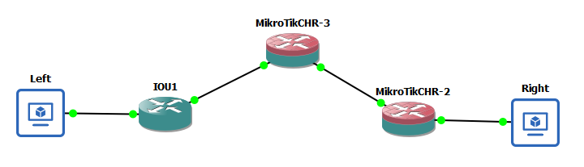
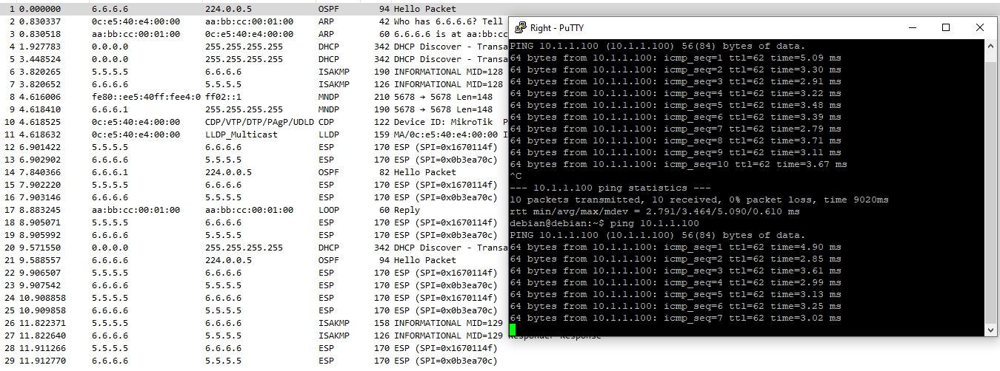
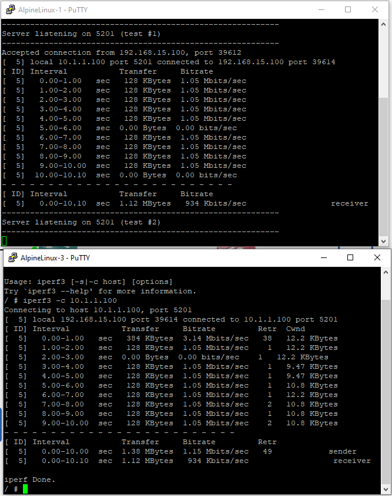
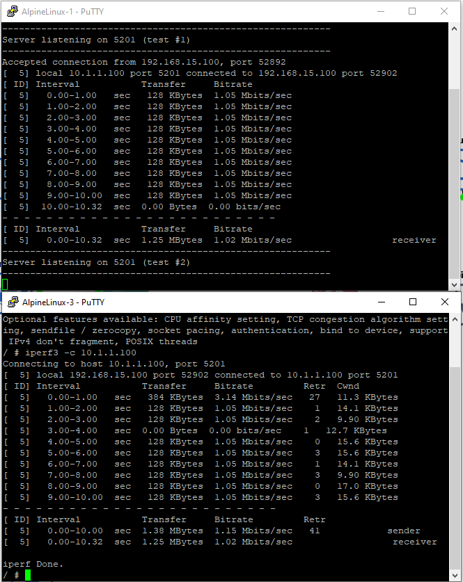

# Site-to-site IPsec между Cisco и MikroTik

Я связал в GNS3 две сети через туннель IPsec между Cisco IOS и MikroTik RouterOS. Хотел проверить весь путь пакета: между какими узлами работает приложение, какой трафик шлюзы выбирают для шифрования и что при этом видно в транзитной сети.

За Cisco находилась сеть `10.1.1.0/24`, за MikroTik — `192.168.15.0/24`. Конечные узлы общались по внутренним адресам. Параметры шифрования и выбор трафика я настроил на шлюзах.

## Как согласовал настройки двух платформ

На Cisco создал предложение IKEv2 с AES-256-CBC, SHA-256 и группой DH 14. Привязал удалённого соседа к профилю с аутентификацией по общему ключу. Для трафика между подсетями задал ESP в туннельном режиме с AES-256 и HMAC-SHA-256. В crypto map связал профиль, transform set и ACL, после чего применил карту к внешнему интерфейсу GigabitEthernet0/0.

На MikroTik настроил соответствующие profile, peer и proposal. В policy указал локальную сеть источником, а сеть за Cisco — назначением. На Cisco ACL описывает обратное направление. Для PFS выбрал на обеих сторонах одну группу: в Cisco IOS она называется group14, в RouterOS — modp2048. В опубликованных файлах внешние адреса заменил на тестовые, общий ключ — на заглушку. [Cisco IOS](cisco-ios.conf) · [MikroTik RouterOS](mikrotik.rsc)

## Как убедился, что трафик идёт через туннель

Проверил связь с удалённым узлом и одновременно посмотрел захват между шлюзами. Справа на снимке видны ответы на ping, слева в Wireshark — пакеты ESP в обоих направлениях. Адреса источника и назначения во внешнем заголовке принадлежат шлюзам. Так я связал результат на конечном узле с тем, что передавалось по транзитному каналу.

## Сравнение передачи с IPsec и без него

Запустил iperf3 с узла `192.168.15.100` на `10.1.1.100` по TCP/5201. Провёл по одному измерению в каждом режиме. Для скорости взял строку receiver, для повторных передач — столбец Retr у отправителя.

| Режим | Скорость у получателя | Принято | Повторные передачи TCP |
|---|---:|---:|---:|
| С IPsec | 934 Кбит/с | 1,12 МиБ | 49 |
| Без IPsec | 1,02 Мбит/с | 1,25 МиБ | 41 |

**С включённым туннелем.** В нижней части вывода видны разные значения у отправителя и получателя. Получатель зафиксировал 934 Кбит/с.

**Без туннеля.** Повторил измерение между теми же адресами. Получатель зафиксировал 1,02 Мбит/с. Разница между двумя замерами составила около 8 %. Это результат конкретной пары прогонов на виртуальном стенде.

